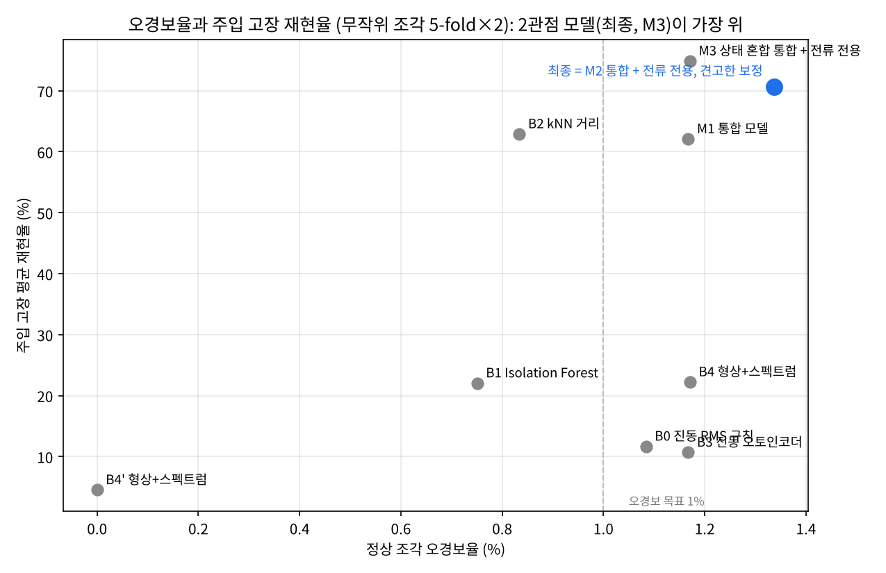
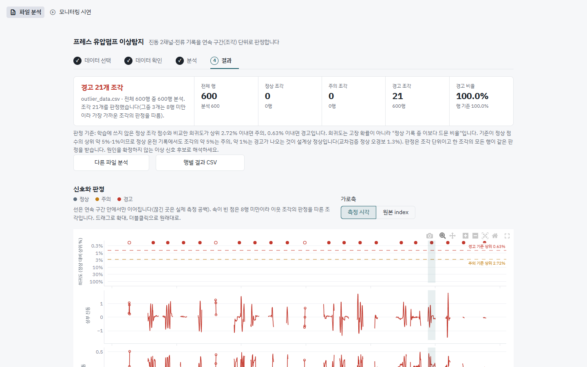
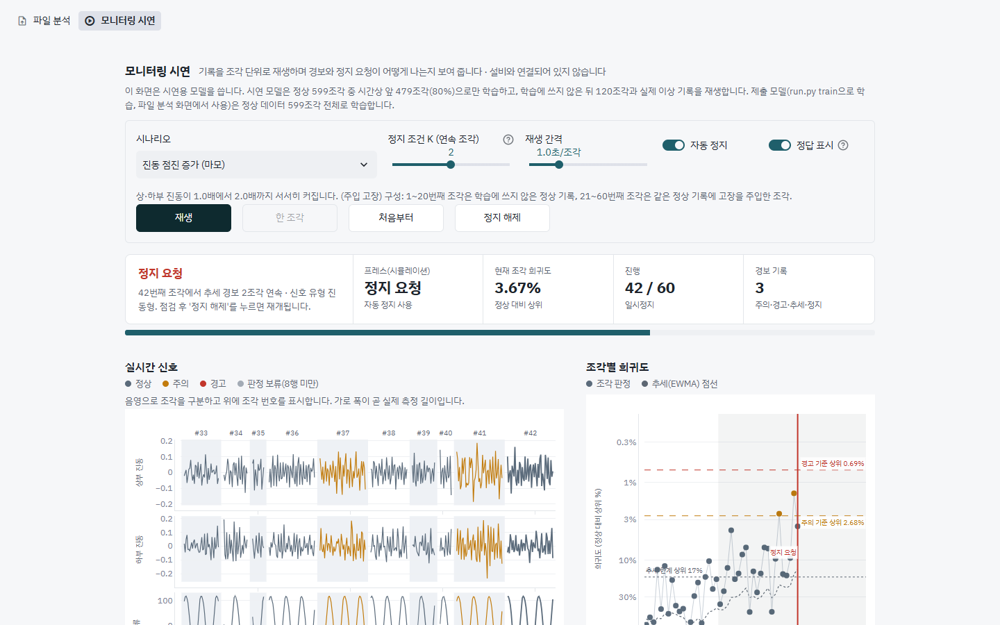

# 프레스 유압펌프 이상 조기탐지

[](https://github.com/iaynu/THJ-press-pump-anomaly-detection/actions/workflows/tests.yml)

2026 제6회 K-인공지능 제조데이터 분석 경진대회(KAMP) 과제 ③ 출품작입니다. 팀 THJ.
진동·전류 시계열로 프레스 유압펌프의 이상을 **조기에 탐지**하고, **오경보를 줄이는 방법을 검증**합니다.
이상 라벨이 거의 없는 제조 현장을 가정해, 정상 데이터만으로 "정상 기준에서 얼마나 벗어났는가"를 잽니다.

> **실제 이상은 하루치 기록의 21조각뿐입니다.** "실제 이상 재현율 100%"는 이 기록이 정상과 크게 다르다는 뜻이고, 다른 종류의 고장 성능을 보장하지 않습니다. 주입 고장 재현율은 우리가 정한 고장 모양에 대한 값입니다. 자세한 한계는 [docs/04_한계_및_향후과제.md](docs/04_한계_및_향후과제.md).



## 팀

팀 THJ: 이용직, 박주현, 황창연

## 목차
1. [핵심 결과](#1-핵심-결과)
2. [방법](#2-방법)
3. [구조](#3-구조)
4. [빠른 시작](#4-빠른-시작)
5. [앱](#5-앱)
6. [데이터와 결과물](#6-데이터와-결과물)
7. [테스트](#7-테스트)
8. [문서](#8-문서)
9. [알려진 한계와 주의](#9-알려진-한계와-주의)

---

## 1. 핵심 결과

| 항목 | 결과 |
|---|---|
| 정상 조각 오경보율 | 1.3% (무작위 5-fold×2) / 1.7% (시간 블록) / 0.8% (순방향) |
| 실제 이상 21조각 재현율 | 100% (세 프로토콜 모두) |
| 주입 고장 11종 평균 재현율 | 71% (F1 0.79) |
| 1샘플 전류 튐에 경고하는 비율 | 2.5% (튐 복원 도입 전 20.6%) |
| 같은 오경보 수준의 비교 모델 | 형상+스펙트럼안 22%, 진동 RMS 규칙 12% |

같은 분할·같은 OOF 보정(경고 = 정상 OOF 점수 q99)에서 모델을 비교했습니다(무작위 5-fold×2, [03_결과](docs/03_결과.md) 7.1절).

| 모델 | 오경보율 | 실제 이상 재현율 | 주입 고장 재현율 | 1샘플 튐 경보 |
|---|---|---|---|---|
| 진동 RMS 규칙 | 1.1% | 81% | 11.7% | 1.0% |
| Isolation Forest | 0.8% | 94% | 22.1% | 2.8% |
| kNN 거리 | 0.8% | 100% | 62.9% | 15.2% |
| 오토인코더 | 1.2% | 96% | 10.7% | 1.2% |
| 형상+스펙트럼안 | 1.2% | 100% | 22.2% | 82.0% |
| 9특징 MCD (M1) | 1.2% | 100% | 62.1% | 6.8% |
| **최종 (2관점 MCD + 견고 보정 + 튐 복원)** | 1.3% | 100% | **70.6%** | **2.5%** |

표와 그림은 모두 코드로 다시 만들 수 있습니다. 전체 표는 [docs/03_결과.md](docs/03_결과.md).

## 2. 방법

1. **조각 분할**: 0.5초 넘게 끊기면 새 조각입니다. 분할은 윈도우를 자르기 전에 조각 단위로 해서 겹치는 윈도우가 새지 않게 했습니다.
2. **9특징**: 진동 6(상·하부 RMS, 피크, 합·차 RMS) + 전류 3(0.6Hz 사인 맞춤의 중심선·진폭·왜곡). 1샘플 튐은 조각 전체 합의로 복원합니다.
3. **두 관점 MCD**: 통합 9특징과 전류 3특징에 강건 마할라노비스 거리를 따로 학습하고 max로 합칩니다.
4. **보정**: 학습 조각을 5겹으로 나눈 out-of-fold 점수로 정상 백분위를 만들고, 주의 q95·경고 q99를 정합니다. 라벨 오염에 대비해 이상치 조각은 임계값 계산에서 뺍니다.
5. **운용 규칙**: 엄격 단일(q99.7) 또는 EWMA 추세 규칙, 진동형/전류형/복합형 진단.

설계 근거와 기각한 접근은 [docs/02_파이프라인_및_설계.md](docs/02_파이프라인_및_설계.md).

### 성능 개선 과정

모델을 키운 것이 아니라 오경보의 원인을 찾고 임계값을 정직하게 재는 일이 성능을 만들었습니다. 핵심 세 가지:

1. **오토인코더·Isolation Forest를 버리고 물리 기반 특징 + MCD로**: 같은 평가에서 오토인코더 10.7%, Isolation Forest 22.1%, 최종 70.6%. 계획한 개선안이 개선이 아니라는 것은 같은 잣대로 비교해야 알 수 있었습니다.
2. **OOF 임계값**: 학습 점수로 임계값을 재면 오경보가 과소 추정됩니다. 5-fold OOF 점수로 정하고 무작위·시간 블록·순방향 세 분할에서 모두 오경보 0.8~1.7%를 확인했습니다.
3. **라벨 오염 방어**: "정상 라벨에 고장이 섞여도 MCD는 유지된다"는 가정을 다시 재 보니 틀렸습니다. 임계값이 오염된 점수로 올라가 오염 2%만으로 재현율이 32%로 떨어졌고, 강건 z>3.5 보정으로 91%를 회복했습니다.

| 단계 | 바꾼 것 | 결과 |
|---|---|---|
| 특징 설계 | 진동 RMS·피크·합·차 + 전류 0.6Hz 사인 맞춤(중심선·진폭·잔차비) | 9특징 MCD가 kNN·IF·AE보다 높음 |
| 튐 보정 | 1샘플 전류 튐을 조각 전체 합의로 복원 | 1샘플 튐 경보 약 20% → 2.5% |
| 오경보 원인 제거 | 저부하에서 부호가 뒤집히는 상·하부 상관 특징 제외 | 저부하 오경보 0% |
| 길이별 윈도우 | 24/16/8행을 길이별 모델로, 8행 미만은 이웃 판정 | 모든 조각에 판정 부여 |
| 두 관점 융합 | 통합 9특징 + 전류 전용 3특징, 백분위 max | 주입 고장 62.1% → 70.6% |
| 스트림 경보 | 엄격 단일(q99.7) + EWMA(λ=0.2) | 시간당 에피소드 7.1 → 3.1 |

각 단계의 문제 상황, 시도, 이유, 기각한 접근은 [07_성능_개선_과정](docs/07_성능_개선_과정.md)에 정리했습니다.

## 3. 구조

```
.
├── run.py            진입점: train / predict / evaluate / all
├── app.py            Streamlit 앱 진입점
├── views/            앱 화면: analysis.py(파일 분석), monitor.py(모니터링 시연)
├── src/kamp/        핵심 코드 (추론·앱이 쓰는 모듈)
│   ├── data.py features.py detectors.py system.py models.py analysis.py   조각 분할, 특징, 탐지기, 보정, 모델 구성, 파일 분석
│   ├── faults.py                                                          고장 주입
│   ├── ui.py dashboard_core.py                                            앱 지원
│   └── experiments/  평가·보고서 생성 (python run.py evaluate가 호출)
│       evaluate sensitivity trim_sweep contamination regime_check port glitch_fix notebook_compare* report
├── data/             대회 제공 원본 CSV 2개
├── models/           학습된 모델 (final_system.pkl 제출용, dashboard_system.pkl 시연용)
├── results/
│   ├── predictions_*.csv   원본 두 파일의 행 단위 예측
│   ├── tables/ figures/    결과 표 17개, 그림 F1~F7
│   ├── raw/ notebook_compare/   실험 원자료, 팀 노트북 비교
│   └── logs/               실행 기록
├── tests/            pytest
├── Dockerfile        Python 3.13 실행 환경 (SAC가 막는 Windows용)
├── docs/             설계·결과 문서, 결과 보고서(pdf), 발표 자료, images/(앱 스크린샷)
└── .streamlit/       앱 테마
```

## 4. 빠른 시작

Python 3.13에서 검증했습니다.

```bash
pip install -r requirements.txt

python run.py train                                    # 최종 모델 학습 (~30초) -> models/
python run.py predict --input data/outlier_data.csv    # 행 단위 예측 -> results/predictions_outlier_data.csv
streamlit run app.py                                   # 분석·모니터링 앱
python run.py evaluate                                 # 전체 실험과 표·그림 재생성 (~60분, 2코어 기준)
```

`python run.py all`은 train, 두 원본 파일 예측, evaluate를 차례로 실행합니다.

**Windows 스마트 앱 컨트롤(SAC)이 켜져 있으면** 서명 없는 scikit-learn 확장 모듈(`_isotonic*.pyd`)이 차단되어 `ImportError: DLL load failed`가 납니다. 이때는 Docker로 실행하세요(Python 3.13 환경이 그대로 재현됩니다).

```bash
docker build -t kamp-thj .
docker run --rm kamp-thj python -m pytest -q                      # 테스트
docker run --rm -p 8501:8501 kamp-thj                              # 앱 -> http://localhost:8501
docker run --rm -v "$PWD/results:/app/results" kamp-thj python run.py predict --input data/outlier_data.csv
```

**Windows PowerShell에서 Docker Desktop을 사용하는 경우**, PowerShell은 Linux의 `$PWD`를 Windows 경로로 전달하므로 결과 폴더 마운트에는 PowerShell 경로를 따옴표로 감싸서 사용하세요.

```powershell
docker build -t kamp-thj .
docker run --rm kamp-thj python -m pytest -q
docker run --rm -p 8501:8501 kamp-thj
docker run --rm -v "${PWD}/results:/app/results" kamp-thj python run.py predict --input data/outlier_data.csv
```

앱은 `http://localhost:8501`에서 열립니다. 마지막 예시는 현재 폴더의 `results`를 컨테이너와 공유하며, 해당 폴더가 없으면 실행 전에 `New-Item -ItemType Directory results -Force`로 만들어 주세요.

입력 CSV는 대회 파일과 같은 형식입니다: `index, TimeStamp, AI0_Vibration, AI1_Vibration, AI2_Current` (`Equipment_state`는 없어도 됩니다).
결측·중복·시각 오류 행도 결과 파일에 모두 남고, `row_status` 열에 처리 방식이 표시됩니다. 예측 파일의 열 설명은 [docs/01_제출물_구성_및_실행.md](docs/01_제출물_구성_및_실행.md).

## 5. 앱

`streamlit run app.py`로 두 화면을 엽니다.

### 파일 분석

CSV를 올리면 검증하고, 조각별 정상 백분위·주의/경고 단계·진단(진동형/전류형/복합형)을 보여 줍니다. 행별 결과 CSV를 내려받을 수 있습니다.



### 모니터링 시연

정상 조각, 실제 이상 기록, 주입 고장을 한 조각씩 재생하며 2단계 경보와 연속 조건 정지 요청을 시연합니다. 아래는 진동이 서서히 커지는 시나리오에서 42번째 조각에 추세 경보가 2조각 연속되어 정지 요청이 나온 장면입니다.



화면 설명은 [docs/06_앱.md](docs/06_앱.md).

## 6. 데이터와 결과물

| 항목 | 위치 |
|---|---|
| 학습 데이터 | `data/press_data_normal.csv` (정상 20,000행, 599조각), `data/outlier_data.csv` (이상 600행, 21조각) |
| 학습된 모델 | `models/final_system.pkl` (정상 599조각 전체로 학습) |
| 예측 결과 | `results/predictions_outlier_data.csv`, `results/predictions_press_data_normal.csv` |
| 교차검증 예측 | `results/raw/*_segments.csv` (학습에 쓰지 않은 조각의 예측) |
| 결과 표·그림 | `results/tables/`, `results/figures/` |

대회에서 별도 테스트 파일이 제공되지 않아, 제공 이상 기록과 교차검증의 시험 조각을 테스트데이터로 썼습니다.

## 7. 테스트

```bash
pip install pytest
python -m pytest -q
```

조각 분할과 입력 검증을 확인하고, 학습된 모델이 있으면 두 원본 파일의 예측이 문서의 수치(이상 21조각 모두 경고, 정상 경고 조각 2% 미만)와 맞는지 확인합니다.

## 8. 문서

| 문서 | 내용 |
|---|---|
| [01_제출물_구성_및_실행](docs/01_제출물_구성_및_실행.md) | 대회 요구 항목 대응, 폴더 구조, 실행, 예측 파일 열 |
| [02_파이프라인_및_설계](docs/02_파이프라인_및_설계.md) | 파이프라인, 채택·기각한 접근, 평가 설계, 비교 모델 |
| [03_결과](docs/03_결과.md) | 모델 비교, 프로토콜별, 고장 유형별, 반증 점검, 스트림, 라벨 오염 |
| [04_한계_및_향후과제](docs/04_한계_및_향후과제.md) | 주장 범위와 한계, 보완 과제 |
| [05_노트북_비교_및_튐_복원](docs/05_노트북_비교_및_튐_복원.md) | 팀 노트북과의 비교, 1샘플 튐 경보 줄이기 |
| [06_앱](docs/06_앱.md) | 분석·모니터링 앱 |
| [07_성능_개선_과정](docs/07_성능_개선_과정.md) | 9단계 개선 과정, 개념 설명, 기각한 접근 |
| [결과 보고서](docs/THJ_결과보고서.pdf) · [발표 자료](docs/THJ_발표자료.pdf) | 대회 제출물 |

절 번호(7.4절 등)는 원래 상세 설명서의 번호를 그대로 썼습니다.

## 9. 알려진 한계와 주의

- **실제 이상 21조각, 기록 하나**: 성능 일반화는 보장하지 않습니다. 이상의 원인(펌프 이상인지 다른 조건인지)도 확정하지 않았고, 진단은 "어느 센서 쪽이 정상에서 벗어났는가"까지만 말합니다.
- **10Hz 샘플링**이라 0~5Hz만 봅니다. 모터 전기 고장이나 베어링 결함 주파수는 볼 수 없습니다.
- **희귀도(1−p)는 고장 확률이 아닙니다.** "정상 기록 중 이보다 드문 비율"입니다.
- **센서 교정에 민감합니다.** 센서 이득이 1.2배가 되면 정상 조각의 37%가 경고됩니다(7.4절). 운용 시 교정 확인이 필요합니다.
- **저부하 상태의 진동 고장을 놓치기 쉽습니다.** 상태 혼합(M3)으로 개선되지만 라벨 오염에는 더 약해, 최종 모델은 M2 구조를 씁니다(7.3, 7.6절).
- **`models/*.pkl`은 pickle**이라 `requirements.txt`의 scikit-learn 버전과 맞아야 하고, 출처를 모르는 pickle은 열면 안 됩니다. 버전이 다르면 `python run.py train`으로 다시 만드세요.
- 데이터는 KAMP(한국인공지능제조플랫폼)가 대회에서 제공한 것입니다. 재배포 조건은 KAMP 이용 약관을 확인하세요.
